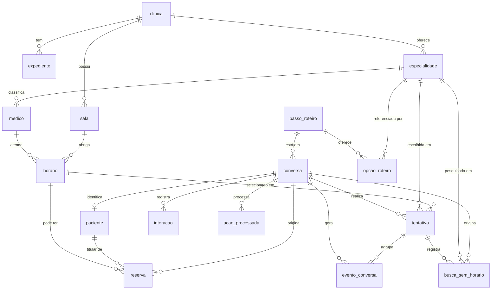

# Diagrama entidade-relacionamento

Notas de leitura:

- `conversa` tem no máximo um `paciente` (coluna `id_paciente`, nullable). Paciente pertence a exatamente um contato, por isso `paciente` guarda `id_conversa` único.
- `reserva` referencia `horario` e `paciente`. A unicidade de reserva ativa por horário está no índice parcial, descrito no dicionário.